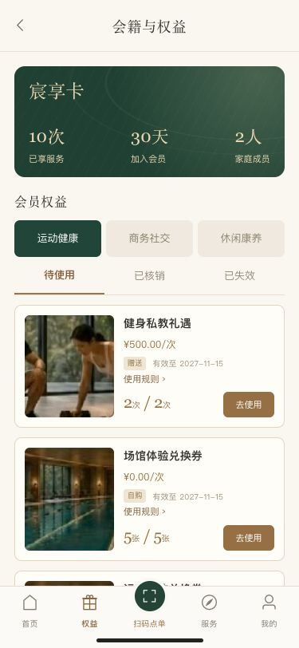
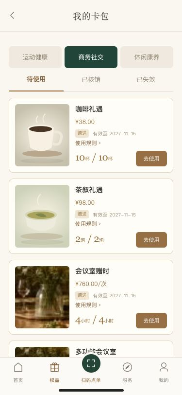
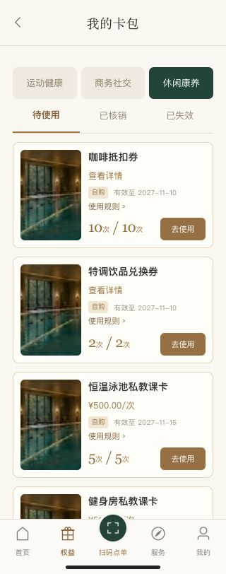

# V4.24.1 图文卡片样式核验

2026-11-20，针对“左图右文的组件样式仍有问题”复核并修复。

原布局把图片、正文和操作分成三列，375px页面中的正文仅129px，放大图片后名称、有效期和价格被挤压。本次改为左图、右侧两行布局：图片跨两行，右上显示名称和规则信息，右下显示数量或会员价格与操作。图片统一内边距，320px窄屏同步适配。

修改范围为`v13-owner.css`中的`.owner-device .v19-benefit`共用样式和资源版本标识。卡包与权益共用修复；其余组件的原有布局保持。

| 核验范围 | 结果 |
| --- | --- |
| U03权益：待使用、已核销、已失效 | 17张卡片检查通过 |
| U20卡包：商务社交、休闲康养，含320px窄屏 | 22张卡片检查通过 |
| 1440×900下的手机预览 | 9张卡片检查通过 |
| U18推荐列表、U36关注、U24订单 | 137项图文边界检查通过，图片加载正常 |
| U05服务、U10预约 | 复核原有展示结构；本次未修改 |
| 现有业务测试 | 327项通过，0失败 |
| Git差异检查 | `git diff --check`通过 |

卡片检查涵盖图片与文字的左右关系、正文与操作是否重叠、文字和按钮是否超出卡片、图片上下内边距。详细DOM测量保存在[layout-audit.json](layout-audit.json)。

测试命令：`node --test tests/*.test.cjs`。

