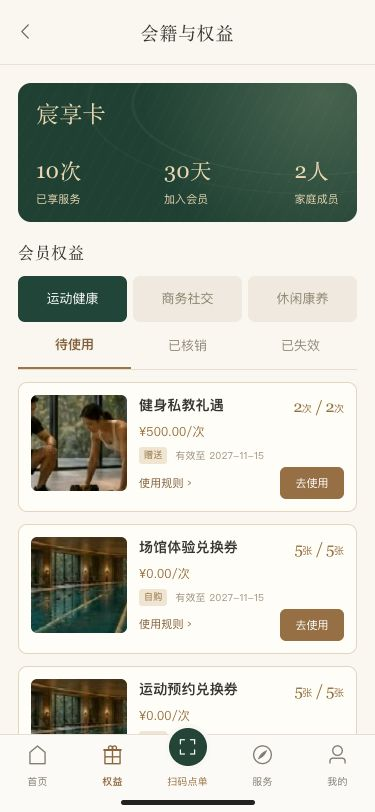
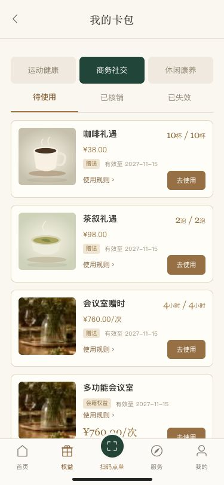
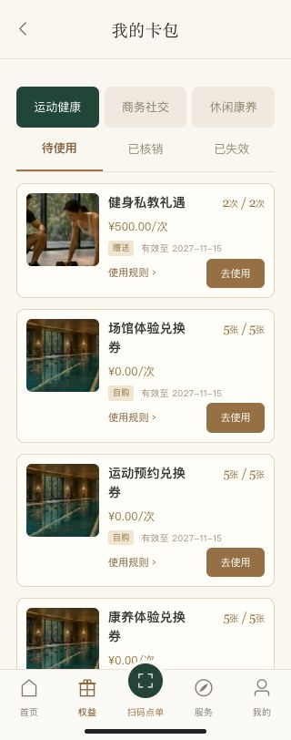

# V4.24.2 方图与次数位置调整

按2026-11-20反馈调整权益、卡包共用组件：

- 缩略图固定为96×96px正方形；360px以下窄屏为80×80px，取消随卡片高度拉伸。
- 可用次数/总次数移至右上方，与名称分开预留空间。
- 卡片基础高度缩至122px；长名称按内容自适应，按钮保持右下方。

仅修改`v13-owner.css`对应组件与该样式资源的版本标识。

验证：U03三种状态、U20商务社交与运动健康，覆盖375×812、320px窄屏及1440×900预览，共51张卡片测量，图片宽高相同、次数与名称无重叠、按钮与正文无重叠、内容未超出卡片。原有327项业务测试通过，0失败；`git diff --check`通过。

具体尺寸和位置测量见[layout-audit.json](layout-audit.json)。

