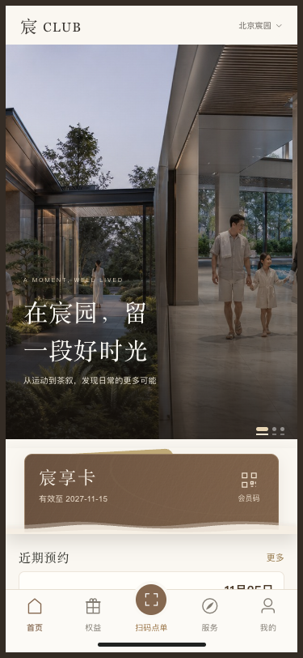
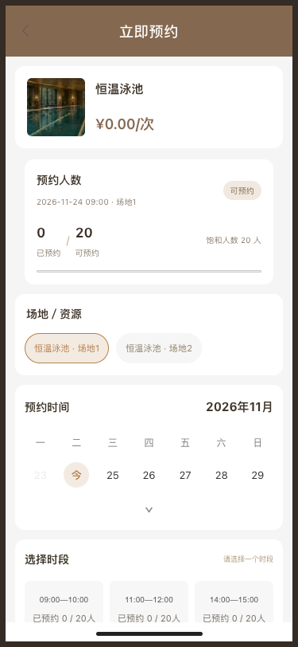
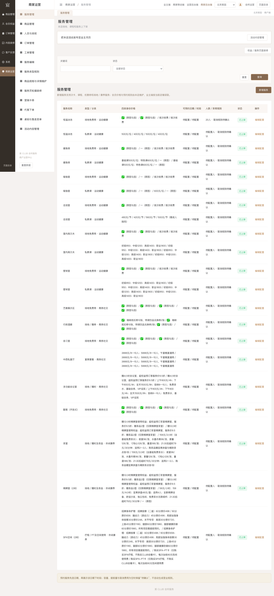

# V0.12 调整核验记录

依据《小程序调整- V0.12.docx》逐项核验，共 9 项：

1. 购物车和订单详情头部统一为宸 CLUB 暖棕色，并沿用页面相邻色块。
2. 首页活动月历位于今日可约区域之后。
3. 首页近期预约读取当前项目有效待履约预约；无数据时展示空状态和发现服务入口。
4. 预约人数只出现在预约流程，不再出现在服务详情页。
5. 泳池首页卡片和预约页按所选日期、时段、场地复用容量模型显示已预约与可预约人数。
6. 桌码下载图合成会所、项目、桌号、场景和绑定菜单信息。
7. 商家移动端导航保留工作台、代客预约、扫码点单、核销和订单入口。
8. 会员预约自动带出会员姓名和联系方式；非会员联系电话置空并要求手动填写；确认页保留联系人信息。
9. 新增会员登录页，游客预约、购买和购物车结算时进入登录，演示登录后返回原业务页面。

验证结果：`node --test tests/*.test.cjs` 共 417 项通过，0 失败；三会所 × 四身份 × 1,440 次页面渲染检查通过；移动端容器闭合与底栏检查通过。Chrome 实测移动首页和预约页（375 × 812）、商家后台（1440 × 900）均无脚本错误。截图：、、。

相关实现：[v16-adjustments.js](../../../../v16-adjustments.js)、[v16-adjustments.css](../../../../v16-adjustments.css)、[v16 回归测试](../../../../tests/v16-adjustments.test.cjs)。
