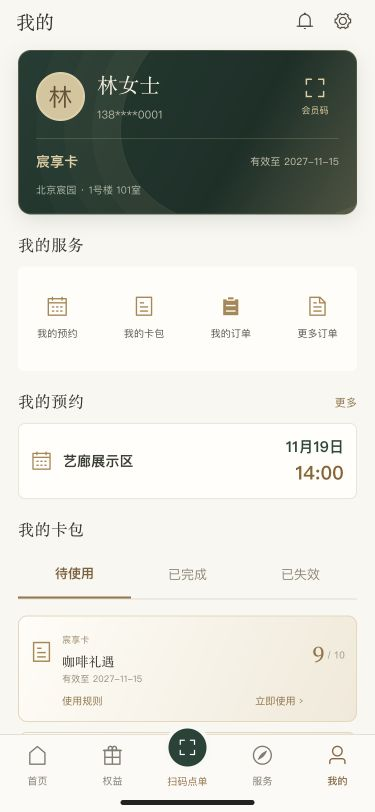

# 4.18.1 个人中心与首页核验

本次按照最新两张参考图调整首页，并复核 V0.1—V0.8 中与个人中心、卡包、服务入口、订单及其后台维护有关的条目。以后续版本和本次明确要求为准，覆盖早期冲突项。

## 核验结果

| 来源／要求 | 发现与修正 | 页面／维护位置 | 结果 |
| --- | --- | --- | --- |
| 本次：首页近期预约左服务、右日期时间 | 原版本名称和日期都在右侧；改为左侧日历图标与服务，右侧日期、时间分层突出，移除去使用 | U01、U05、U12，共用组件 | 已修复 |
| 本次：首页会籍卡套 | 增加卡片插入卡套、下部遮挡的层次；仅卡名和有效期两项文字 | U01；A24卡名，A07／A21会员有效期，A10预览 | 已修复 |
| V0.1、V0.4、V0.6及本次：会员基本信息 | 恢复原深绿金色会员卡；保留头像、姓名、手机、右侧会员码、卡名、有效期、房产，顶部消息与设置图标 | U12、U15；A07／A21会员维护 | 已修复 |
| V0.6：我的预约与首页、服务一致 | 个人中心原独立预约样式改为共享近期预约组件 | U01、U05、U12 → U09 | 已修复 |
| V0.4、V0.6：我的服务、我的订单、更多订单 | 四项入口前置：我的预约、我的卡包、我的订单、更多订单；点单商品与综合订单各自可进入 | U12 → U10／U20／U24／U16 | 已修复 |
| V0.6：卡包同权益、无更多、完整列表 | 我的、权益、卡包独立页调用同一组件，三种状态完整列表，不再保留分叉布局 | U12、U03、U20 | 已修复 |
| V0.8：卡包窄版，已完成数量，失效样例 | 压缩券高度；已完成只显示核销量，失效有印章并保留余量；状态各有至少5条样例；规则页对完成和失效卡关闭使用入口 | U03、U12、U20、U04 | 已修复并实页核验 |
| V0.6：订单筛选、真实商品、多商品、完整详情 | 状态支持待支付／履约中／已完成／已取消／已退款，综合订单增加全部；列表全部商品均展示；取消和退款不再显示准备商品；预约详情显示日期、时间、资源 | U24、U16、U30；A08订单、商家商品管理 | 已修复 |
| 订单回退与导航 | 返回来源列表并保留筛选状态；列表返回我的；综合订单详情保留主导航，扫码跳扫描页 | U30 → U16／U24 → U12 | 已修复并点击核验 |
| V0.1、V0.2：地址与设置分开 | 我的底部独立地址管理；设置可进入资料修改、用户协议、隐私、账户注销等 | U12 → U32；U15 | 已修复 |
| 头像维护 | 后台头像和有效期维护已回归验证；账户设置页同步显示会员头像 | A07／A21 → U12、U15、U01 | 已核验 |
| 前后台一致性 | A24仅维护首页卡名，会员有效期在会员管理维护；装修页选中会籍组件可直接配置，不跳离画布，预览采用新卡套 | A24、A07／A21、A10 | 已实页核验 |

## 浏览器证据

移动375×812px：

1. 首页下滑，核对卡套、两项文字和近期预约左右布局；整卡进入凭证。
2. 我的会员卡、四项服务、共享预约、三状态卡包；已完成核销数、失效印章与5条失效记录。
3. 点单订单状态切换、多商品详情、取消说明；综合订单预约日期／时间／场地、来源返回及筛选保留。
4. 独立地址页新增入口打开地址表单；设置中可修改个人资料。
5. 服务页面的近期预约与首页一致，服务列表可正常滚动。

PC1440×900px：会籍配置三个身份预览，以及装修页会籍组件选中、配置和新预览。

[失效卡包](UI稿/V418/07-失效卡包.png) · [商品订单](UI稿/V418/08-订单调整后.png) · [订单详情](UI稿/V418/09-订单详情调整后.png) · [预约订单详情](UI稿/V418/10-更多订单预约详情.png) · [服务页](UI稿/V418/11-服务页.png) · [会籍维护](UI稿/V418/12-会籍配置.png) · [运营装修](UI稿/V418/13-运营装修预览.png)

## 自动回归与边界

133项自动检查全部通过，含共享近期预约、综合与点单订单区分、多商品完整性、失效卡使用入口、详情来源返回、扫码导航及既有三会所路由、价格、预约、支付等回归。新增7项覆盖本次发现的实际遗漏。

本次没有改写客户权益及收费数据。页面数据依旧为本地交互原型，未接生产接口；相机实机权限与真实支付不属于此次浏览器核验。未将本次个人中心复核表述为所有历次文档、所有业务功能的完整生产验收。

## 设计核对

服务名与日期时间具有独立对齐区域；时间采用较大金色数字，便于扫读。会员卡沿用原深绿金色与弧形纹理；卡套用层叠、遮挡及缝线提示实体卡包。各状态保留文字标识，整卡和图标入口具有可访问名称。

修复循环中发现综合订单详情扫码链接沿用桌码，已补排除规则并通过浏览器加载新资源版本确认链接为扫描页；详情返回绕开历史筛选轨迹，直接回来源列表。卡面文字颜色已复核，避免旧装修样式叠加降低可读性。

本次上述页面和流程未发现遗留的阻断问题。截图保留当前演示会员、当前运营装修配置与本地订单状态；不同已有浏览记录的样例数量、近期预约日期可能不同。
